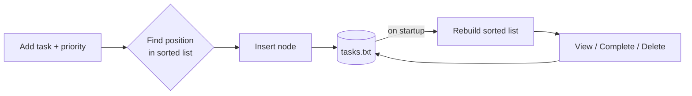

<div align="center">

# ✅ Prioritask

**A fast, lightweight priority to-do manager for your terminal — written in modern C++.**


</div>

---

## 📖 Overview

Prioritask keeps your tasks **automatically sorted by priority**, so the most important thing is always at the top. Tasks are stored in a hand-built **singly linked list**, and everything is saved to a plain text file, so your list is still there the next time you open the app.

No libraries, no setup, no database. Just the C++ standard library.

> Want the short version of the idea? See [`docs/OVERVIEW.md`](docs/OVERVIEW.md).

## ✨ Features

| | Feature | Description |
|---|---|---|
| ➕ | **Add tasks** | Give each task a description and a priority from 1 (highest) to 10 (lowest) |
| 📋 | **Sorted view** | Tasks are always shown in priority order, with status and timestamp |
| 🎯 | **Next task** | Instantly see the highest-priority task that is still pending |
| ✔️ | **Mark complete** | Track what is done and what isn't |
| 🗑️ | **Delete / clear** | Remove one task, or wipe the list (with confirmation) |
| ⏳ | **Pending filter** | View only unfinished tasks |
| 💾 | **Auto-save** | Every change is written to `tasks.txt`; tasks reload on startup |

## 🚀 Quick Start

### Requirements
- A C++17 compiler (`g++` 7+, `clang++` 5+, or MSVC 2017+)

### Build and run

**With Make (Linux / macOS / MSYS2):**
```bash
git clone https://github.com/<your-username>/prioritask.git
cd prioritask
make run
```

**Or compile directly:**
```bash
g++ -std=c++17 -O2 src/main.cpp -o prioritask
./prioritask          # Windows: prioritask.exe
```

## 🖥️ Usage

```text
====================================
  PRIORITY TODO LIST MANAGER
====================================
1. Add Task
2. View All Tasks
3. Get Next Priority Task
4. Mark Task as Complete
5. Delete Task
6. View Pending Tasks Only
7. Save Tasks to File
8. Clear All Tasks
9. Exit
```

Example session after adding a few tasks:

```text
=== PRIORITY TODO LIST ===
Format: [ID] Priority | Description | Status | Added
----------------------------------------------------------------------
[2] P1 | Fix login bug  | Pending | Sun Oct  4 23:35:05 2026
[1] P3 | Write report   | Done    | Sun Oct  4 23:35:05 2026
[3] P7 | Buy groceries  | Pending | Sun Oct  4 23:35:05 2026
----------------------------------------------------------------------
```

## 🧠 How It Works



- **Data structure:** a singly linked list of `Task` nodes, kept sorted on insertion. Lower priority number means closer to the head.
- **Insertion:** `O(n)`, scanning for the right position; equal priorities keep insertion order (first in, first out).
- **Next task:** `O(n)` in the worst case. It returns the first pending node from the head.
- **Persistence:** a simple line-based text format (task counter, then id / description / priority / completed / timestamp per task).
- **Memory safety:** all nodes are freed in the class destructor.

## 📁 Project Structure

```
prioritask/
├── src/
│   └── main.cpp        # Task node, PriorityTodoList class, menu
├── docs/
│   └── OVERVIEW.md     # Short project overview
├── .vscode/            # Optional VS Code build & debug configs
├── Makefile
├── LICENSE
└── README.md
```

## 🛣️ Ideas for Future Improvements

- [ ] Input validation for non-numeric menu entries
- [ ] Edit an existing task's description or priority
- [ ] Due dates and overdue highlighting
- [ ] Colored terminal output
- [ ] Search and filter by keyword
- [ ] Split into header/source files with unit tests

## 🤝 Contributing

Issues and pull requests are welcome. Fork the repo, create a feature branch, and open a PR.

## 📄 License

Released under the [MIT License](LICENSE).
